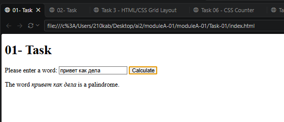
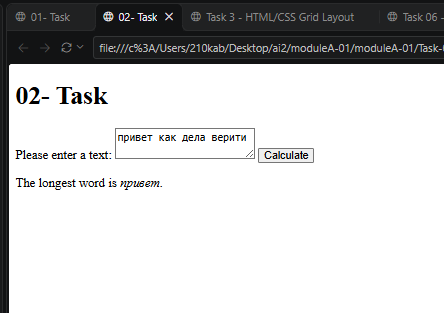
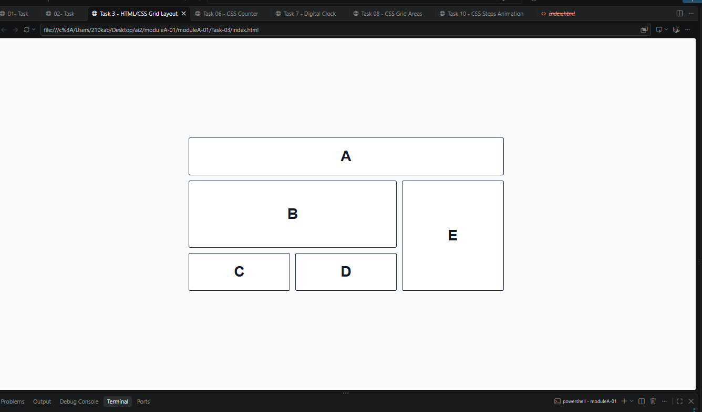
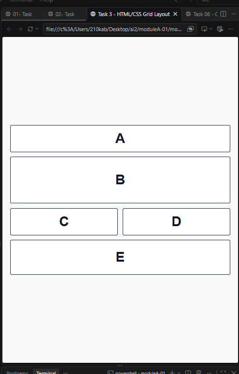
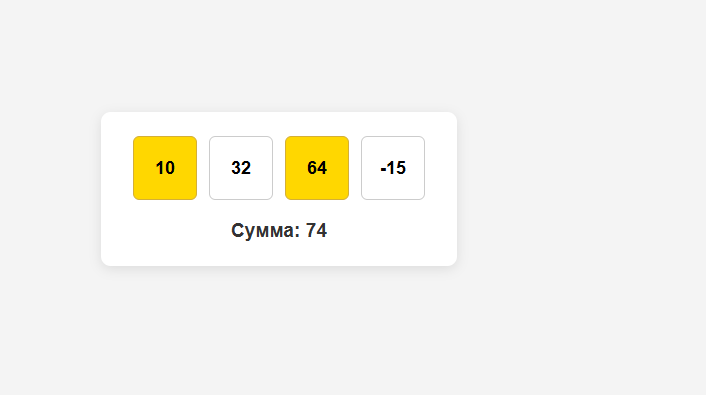
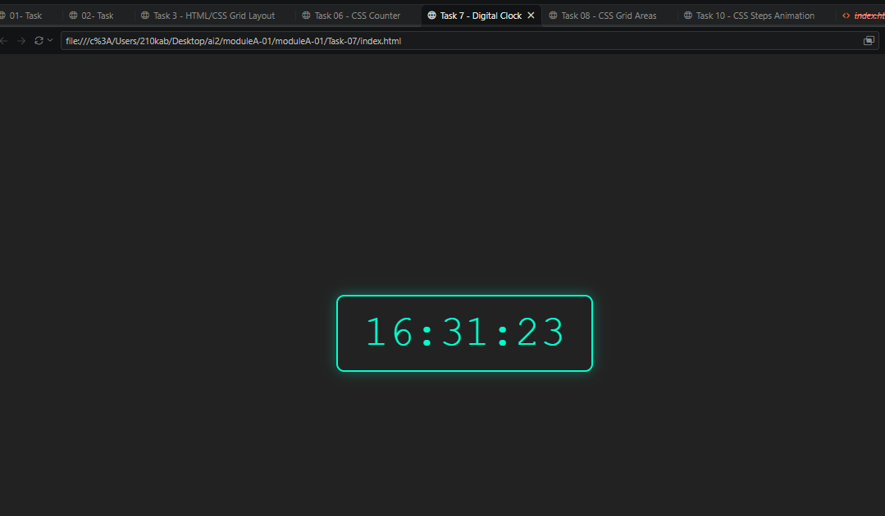
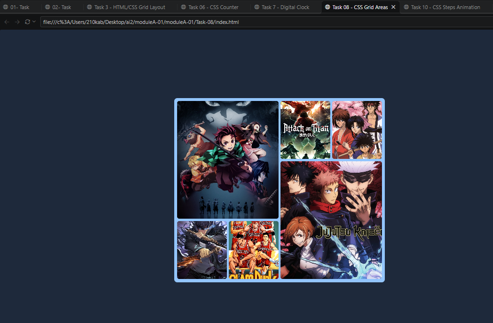
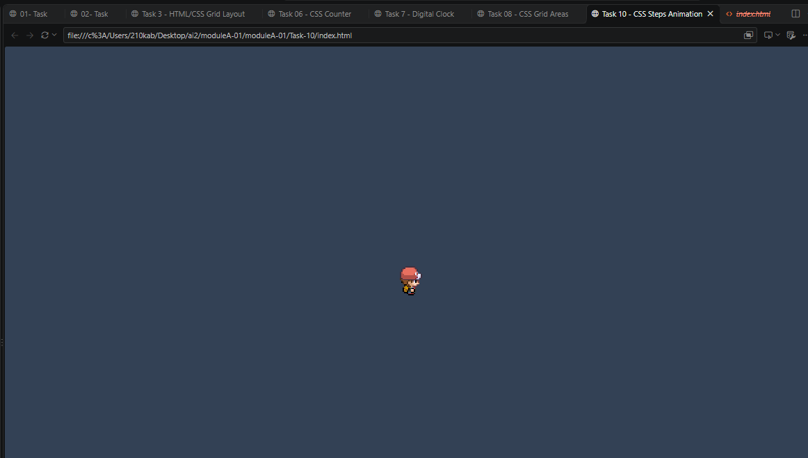

# WorldSkills Kazakhstan 2024 — Module A (Speed Task)

Репозиторий с решениями 10 практических задач по HTML, CSS и JavaScript с иллюстрациями и объяснением кода.

---

## 📋 Разбор и скриншоты всех 10 задач

### 🧩 Task 1: JS Palindromes
* **Описание:** Проверяет, читается ли слово одинаково в обоих направлениях.
* **Скриншот:**

---

### 📏 Task 2: JS Longest Word
* **Описание:** Находит самое длинное слово в переданном тексте.
* **Скриншот:**

---

### 📐 Task 3: HTML/CSS Grid Layout
* **Описание:** Адаптивный макет блоков A, B, C, D, E с точки останова 768px.
* **Скриншот:**

---

### 🔄 Task 4: JS Rotate Strings (shiftedDiff)
* **Описание:** Функция подсчёта сдвигов символов первой строки для получения второй строки.

---

### 🏃 Task 5: JS Fastest Runners
* **Описание:** Анализ и фильтрация результатов забега на 7 км.

---

### 🧮 Task 6: CSS Counter
* **Описание:** Калькулятор выбора чисел на чистом CSS (без JavaScript) с использованием `:checked` и `counter-increment`.
* **Скриншот:**

---

### ⏰ Task 7: JS Digital Clock
* **Описание:** Цифровые часы в формате `ЧЧ:ММ:СС` с обновлением каждую секунду.
* **Скриншот:**

---

### 🖼️ Task 8: CSS Grid Areas
* **Описание:** Коллаж аниме-постеров на CSS Grid (`grid-template-areas`).
* **Скриншот:**

---

### 🔝 Task 9: JS Sum Two Largest Integers
* **Описание:** Поиск и сложение двух наиболших чисел из массива.
* **Скриншот:**

---

### 🚶 Task 10: CSS Steps Animation
* **Описание:** Пошаговая анимация персонажа через `steps(4)` и смещение фона.
* **Скриншот:**

---

## 🛠️ Инструкция по запуску
1. Для HTML/CSS задач откройте `index.html` нужной папки в браузере.
2. Для JS-задач используйте консоль браузера или Node.js.
